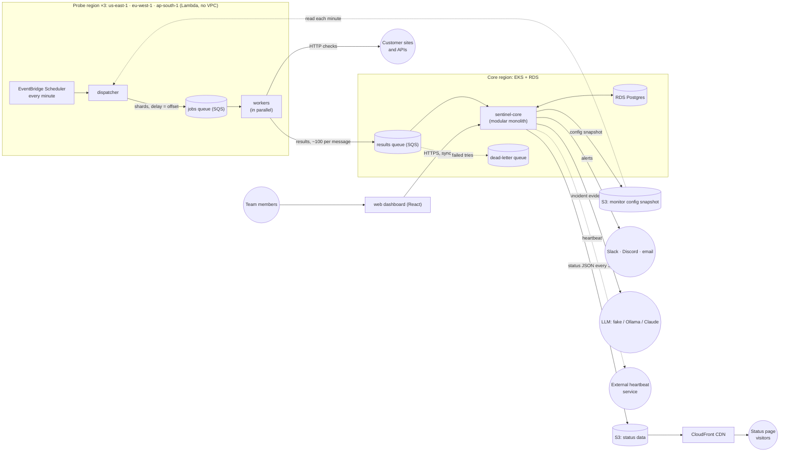
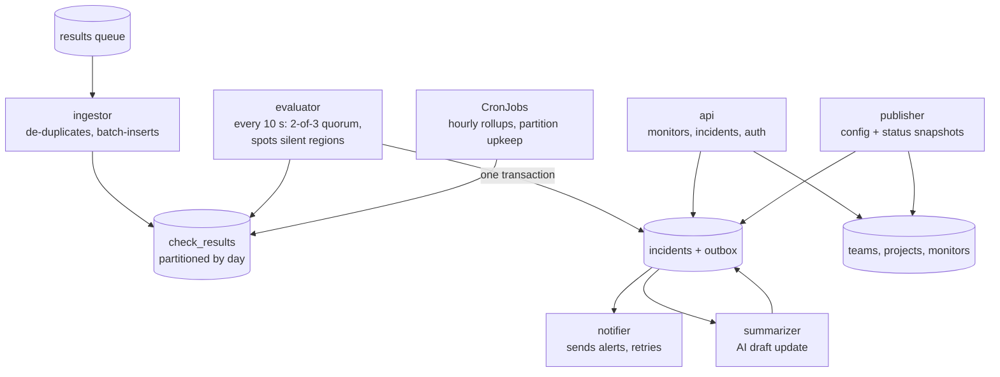

# Sentinel: high-level design (HLD)

| | |
|---|---|
| **Status** | v1 complete (Step 1.1). Low-level design next ([LLD.md](LLD.md), Step 1.2) |
| **Author** | Aadi007-git |
| **Last updated** | 2026-11-01 |
| **Related** | [capacity-estimates.md](capacity-estimates.md) · [roadmap](../roadmap.md) · ADRs in [../adr/](../adr/) |

## 1. Context and goals

Sentinel is a multi-region uptime monitoring service. Teams register the websites and APIs they
care about; Sentinel checks them every minute from three AWS regions, confirms real outages by
quorum, alerts the team, drafts an AI incident update, and publishes a public status page.

**Goals**
- Detect real outages quickly, without false alarms caused by one region's network problems.
- Keep the public status page available even when Sentinel's own core is down.
- Be operable by a small team: automated deployments, full observability, low running cost.

## 2. Product decisions

| # | Decision | Chosen | Why | Date |
|---|---|---|---|---|
| D1 | Who can use Sentinel | **Invite-only teams** (multi-tenant design, sign-up by invitation) | Real multi-tenancy without strangers pointing our probes at arbitrary sites | 2026-11-01 |
| D2 | Fastest check interval | **1 minute** | Industry default; matches EventBridge Scheduler's smallest interval, so one probe run = one round | 2026-11-01 |
| D3 | Outage confirmation rule | **2 of 3 regions failing, for 2 consecutive rounds** | One-off blips never page anyone; real outages still alerted within 3 minutes | 2026-11-01 |
| D4 | Raw check-result retention | **30 days raw**; hourly rollups for 1 year; incidents forever | Minute-level evidence for the current and previous month (uptime disputes); ~260 GB at design target; old days dropped by partition | 2026-11-01 |

## 3. Functional requirements

**Accounts and tenancy**
- **FR1** Users belong to a **team**; a team owns **projects**; a project owns monitors, notification
  channels and one public status page.
- **FR2** Sign-up is **by invitation only**: a team admin invites members by email.

**Monitoring**
- **FR3** Users create, edit, pause and delete **monitors**: URL, HTTP method, expected status code,
  optional keyword to find in the response body, interval (≥ 1 min) and timeout.
- **FR4** Each monitor is checked from **3 regions** at its interval. A check records: up/down,
  HTTP status, response time per stage (DNS → connect → TLS → first byte → total), error type,
  and SSL certificate expiry.
- **FR5** SSL certificates expiring within **14 days** trigger a warning.

**Incidents and alerting**
- **FR6** An outage is **confirmed** when **2 of 3 regions** report failure for **2 consecutive
  rounds**. Recovery is confirmed the same way (2 of 3 regions succeed for 2 rounds).
- **FR7** A confirmed outage **opens an incident**; confirmed recovery **resolves** it.
- **FR8** Incident open/resolve events notify the project's channels: **Slack, Discord, email**.
- **FR9** **AI drafts a plain-English incident update** from the evidence (which regions, which
  errors, latency before the failure). A human approves or edits it before it's published.

**Visibility**
- **FR10** Each project has a **public status page**: current status, 90-day uptime bars, incident history.
- **FR11** Team members see **history**: uptime %, response-time charts per region, past incidents.

**Self-monitoring**
- **FR12** Sentinel **monitors itself**, with an independent alert path that still works if
  Sentinel's core is down (a "dead man's switch").

## 4. Non-functional requirements

| # | Quality | Requirement (measurable) | Notes |
|---|---|---|---|
| NFR1 | Detection speed | **99% of confirmed outages are alerted within 3 minutes** of the outage starting | Follows from D2 + D3; see the worst-case maths in capacity-estimates.md |
| NFR2 | False alarms | A failure seen by **only one region never opens an incident** | Quorum (D3) |
| NFR3 | Availability: status page | **99.95%** per month (≈ 22 minutes of downtime allowed) | Must not share fate with the core: served from the CDN |
| NFR4 | Availability: probing + alerting | **99.9%** per month (≈ 43 minutes) | |
| NFR5 | Availability: dashboard + API | **99.5%** per month (≈ 3.6 hours) | Less critical than alerting |
| NFR6 | Freshness | The status page is **at most 60 seconds** behind reality | Publish every 30 s + 30 s CDN cache |
| NFR7 | Scale | Designed for **10,000 monitors × 3 regions × 1-minute interval**; operated at 20–50 monitors | Design for scale, run small |
| NFR8 | Durability | Once a probe hands a result to the queue, it is **never silently lost**: it is processed, or it lands in a dead-letter queue | |
| NFR9 | Tenant isolation | A team can **only ever see its own** monitors, incidents and settings | Enforced in the API and the data layer |
| NFR10 | Probe safety | Probes **cannot reach private or internal addresses** (cloud metadata service, VPC ranges) | SSRF protection, Step 3.5 |
| NFR11 | Cost | Learning mode **≤ $0.45/hour** while running; always-on showcase **≤ $30/month** | |
| NFR12 | Retention | Raw check results kept **30 days**; hourly rollups **1 year**; incidents and their evidence **indefinitely** | Decision D4 |

## 5. Non-goals

What Sentinel deliberately does **not** do, at least for now:
- Not an APM or logging platform: it checks from the outside and doesn't instrument customers' code.
- No multi-step browser checks (logging in, clicking through pages): HTTP checks only.
- No SMS or phone-call alerts (they cost per message).
- No billing or payments; no open public sign-up.
- No customer-hosted (on-premises) probes.

## 6. Capacity estimates

Full worksheet: [capacity-estimates.md](capacity-estimates.md). Headline numbers at the design target:

- **500 checks/s** on average (30,000 in one second if checks aren't spread across the minute)
- **43.2 million rows/day**, **8.64 GB/day** raw, **~260 GB** kept (30 days)
- Worst-case outage detection **140 s**, within the 180 s target (NFR1)
- Extremely **write-heavy**, so: batch writes, daily partitions, rollups for charts, packed queue messages

## 7. Architecture

### 7.1 Architecture decisions

| ADR | Decision |
|---|---|
| [ADR-0001](../adr/0001-modular-monolith-core.md) | `sentinel-core` is a **modular monolith**: one codebase and one image, run as several roles |
| [ADR-0002](../adr/0002-sqs-for-check-results.md) | Check results travel probe → core through **SQS**, with a dead-letter queue |
| [ADR-0003](../adr/0003-probe-fan-out-with-delay-queue.md) | Each probe region uses a **dispatcher + delay queue** to spread checks across the minute and fan out to parallel workers |

### 7.2 System overview

### 7.3 Inside sentinel-core

### 7.4 Components

| Component | Runs on | Responsibility | Scales on |
|---|---|---|---|
| **dispatcher** | Lambda, each probe region | Every minute: read the config snapshot, put each monitor in a 10-second bucket by `hash(monitor_id) % 60`, split buckets into shards of ≤ 200 monitors, enqueue each shard with `DelaySeconds` = its bucket's offset | 1 run per minute |
| **jobs queue** | SQS, each probe region | Holds shards until their delay expires | Managed |
| **worker** | Lambda, each probe region | Run one shard's checks with a concurrency limit, spread across its 10 s window; pack ~100 results per message; send them to the results queue in the core region | Lambda concurrency (one per shard) |
| **results queue + DLQ** | SQS, core region | Buffer results; keep them up to 14 days if the core is down; move a message to the dead-letter queue after 5 failed attempts | Managed |
| **ingestor** | EKS role | Long-poll the results queue; de-duplicate by `check_id`; batch-insert; delete messages only **after** the database commit | Queue depth (KEDA, Step 3.3) |
| **evaluator** | EKS role | Every 10 s: apply the quorum rule per monitor; mark regions that have gone silent as UNKNOWN; open/resolve incidents and write outbox events **in the same transaction**; send the heartbeat | 1–2 replicas (row locks prevent double work) |
| **notifier** | EKS role | Read outbox events; send to Slack/Discord webhooks and email (Amazon SES); retry with backoff; mark sent | Outbox backlog |
| **summarizer** | EKS role | On incident events: gather evidence → LLM adapter → store a draft; a human approves it in the dashboard | Rarely busy |
| **publisher** | EKS role | On monitor changes: write the config snapshot to S3. Every 30 s: write each project's status JSON to S3 | 1 replica |
| **api** | EKS role | REST API for the dashboard; authentication; enforces tenant isolation (NFR9) | CPU (HPA) |
| **CronJobs** | EKS, same image | Hourly rollups; create tomorrow's partition and drop partitions older than 30 days | Scheduled |
| **web** | Static files | React dashboard for team members | CDN / nginx |
| **status page** | S3 + CloudFront | Static page that reads the status JSON | CDN |

All core roles come from **one image**: `sentinel-core api`, `sentinel-core ingestor`, `sentinel-core rollup`, …

### 7.5 Key flows

1. **Config flow:** a user saves a monitor (sync API call) → the database + an outbox event → the
   publisher rewrites the snapshot in S3 → the dispatchers pick it up on their next run. A change takes
   effect within ~1–2 minutes.
2. **Check flow:** scheduler → dispatcher → jobs queue (delayed by offset) → workers → customer sites →
   results queue → ingestor → `check_results`.
3. **Incident flow:** the evaluator sees 2 of 3 regions failing for 2 rounds → in **one transaction**,
   it opens the incident and writes outbox events → the notifier sends alerts; the summarizer drafts
   an AI update → a human approves it → the publisher includes it in the status JSON.
4. **Status page flow:** the publisher writes status JSON to S3 every 30 s → CloudFront → visitors.
   If the core is down, the page is **still served**, showing its "last updated" time.
5. **Self-monitoring flow:** the evaluator sends a heartbeat to an external service **only if the
   newest check result is less than 2 minutes old**. The heartbeat therefore proves the *whole
   pipeline* is alive (probes → queue → ingestor → evaluator), not just that one process is running.
   If heartbeats stop, the external service alerts the operator.

### 7.6 Sync vs async map

| Interaction | Style | Why |
|---|---|---|
| Dashboard → api | **Sync** (HTTPS) | The user needs an answer now ("monitor saved") |
| Scheduler → dispatcher → jobs queue → workers | **Async** | Spreads load over time; workers run in parallel |
| Workers → results queue → ingestor | **Async** | Probes must never block on, or lose data to, a slow or down core |
| Evaluator → notifier / summarizer (outbox) | **Async** | Alerts survive crashes and get retried; slow Slack or LLM calls never delay detection |
| Publisher → S3 → CDN → visitors | **Async** (published snapshot) | The status page doesn't share fate with the core (NFR3) |

### 7.7 Timing check against NFR1

The processing estimate in capacity-estimates.md was ~10 s. With this architecture, the worst case
adds up as: up to 1 s for the dispatch delay + ~1–2 s for queue long-polling + up to 10 s waiting for
the evaluator's next tick + ~1–2 s for the notifier ≈ **15 s**. The total becomes 60 + 60 + 10 + 15
= **145 s**, still within the 180 s target.

**Design insight:** the evaluator runs on a **timer**, not only when new results arrive, because
you can't detect *silence* with an event: a region that stops reporting sends no event at all.
Spotting missing data needs a clock.

## 8. Open questions (for Step 2.0's failure-mode analysis)

- If the **core region** is unavailable, probes can't deliver results to the queue. What should
  workers do: retry, buffer, or drop with a metric?
- If **S3 config** is unreachable, should dispatchers keep using the last snapshot they read?
- **Clock skew:** results from 3 regions must be grouped into the same "round". Group by the check's
  scheduled minute, not its arrival time? (LLD, Step 1.2.)
