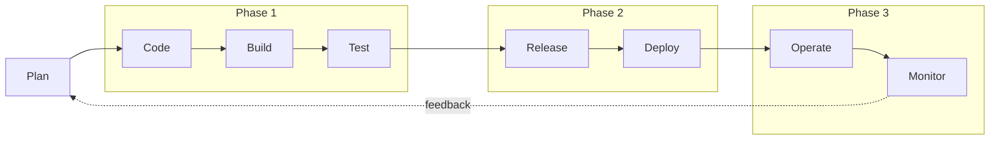

# DevOps fundamentals

> **TL;DR**
>
> 1. DevOps removes the wall between building software and running it: one team owns both, and
>    automation replaces manual handoffs.
> 2. CALMS (Culture, Automation, Lean, Measurement, Sharing) is what that looks like in practice.
> 3. DORA metrics measure it: two for speed, two for stability, and the best teams win on both,
>    because small, frequent changes are safer than big, rare ones.

---

## What it is and why it exists

Traditionally **Dev** (developers) were rewarded for shipping *change*, and **Ops** (operations) were
rewarded for keeping things *stable*. Change is what breaks stability, so the two groups pulled in
opposite directions. Code was "thrown over the wall", releases were rare and huge, and every release
was a risky all-nighter. This is often called the **wall of confusion**.

**DevOps** is the culture, practices and tools that let *one team* ship changes **fast and safely**:
the team that builds a service also runs it, and automation removes the manual handoffs.

> Analogy: a Formula 1 pit crew changes four tyres in ~2 seconds not by rushing, but because every
> step is standardized, rehearsed, automated where possible, and measured.

DevOps is **not** a tool, a job title, or "the person who writes the YAML". Buying Jenkins doesn't
make a company DevOps, just as buying a gym membership doesn't make you fit.

## CALMS: the five pillars

| Pillar | Meaning | In Sentinel |
|---|---|---|
| **C**ulture | Shared ownership: "you build it, you run it"; blameless learning | I design, build *and* operate Sentinel; postmortems are blameless |
| **A**utomation | Machines do repeatable work: build, test, deploy, provision | GitHub Actions, Terraform, Argo CD |
| **L**ean | Small batches, limit work in progress, remove waste | Small PRs, many deploys a day |
| **M**easurement | Decide with data, not opinions | Dashboards, SLOs, DORA metrics |
| **S**haring | Knowledge is written down and shared | This `docs/` folder: notes, ADRs, runbooks |

## The delivery loop

Every change travels around this loop. Each phase of Sentinel automates part of it.

## DORA metrics: how delivery performance is measured

From Google's DORA (DevOps Research and Assessment) research:

| Metric | Question it answers | Type | How Sentinel will measure it |
|---|---|---|---|
| Deployment frequency | How often do we ship to production? | Speed | Count of Argo CD syncs to `prod` |
| Lead time for changes | Commit → running in production: how long? | Speed | Commit timestamp vs deploy timestamp |
| Change failure rate | What % of deployments cause a problem? | Stability | Rollbacks ÷ deployments |
| Failed deployment recovery time | When a deployment breaks things, how fast do we recover? | Stability | Time from a bad canary to recovery |

**Key insight:** the best teams score well on *both* speed and stability. Small, frequent changes
are **less** risky than big, rare ones: a small change is easy to review, easy to test, and easy
to roll back. Speed and safety reinforce each other; they are not a trade-off.

## How Sentinel uses this

- **Phase 1** (Code → Build → Test): every pull request is linted, tested and security-scanned
  automatically, which cuts lead time and catches failures early.
- **Phase 2** (Release → Deploy): infrastructure as code + GitOps make deployments repeatable and
  reversible, which raises deployment frequency and lowers change failure rate.
- **Phase 3** (Operate → Monitor): observability, SLOs and canary releases shorten failed
  deployment recovery time and feed lessons back into planning.

## Key terms

| Term | Meaning |
|---|---|
| **CI** (Continuous Integration) | Every change is merged often and automatically built and tested |
| **Continuous Delivery** | Every change that passes CI *could* go to production at the push of a button |
| **Continuous Deployment** | Every change that passes CI *does* go to production automatically |
| **Pipeline** | The automated sequence of steps a change goes through (build → test → scan → deploy) |
| **Artifact** | The built, versioned output of a pipeline, e.g. a container image |
| **Environment** | A place the software runs: local, dev, staging, prod |
| **IaC** (Infrastructure as Code) | Servers, networks and clusters defined in versioned files (Terraform) |
| **GitOps** | Git is the single source of truth for what should run; an agent (Argo CD) makes reality match Git |
| **Observability** | Being able to understand what a system is doing from its metrics, logs and traces |
| **SRE** (Site Reliability Engineering) | Google's way of doing operations with software engineering; heavy on SLOs and error budgets |
| **Platform engineering** | Building internal self-service tools so product teams can ship without waiting on Ops |

## Common mistakes and misconceptions

- **"DevOps is a team / a job title."** It's a way of working. A separate "DevOps team" that
  developers throw work at just rebuilds the wall in a new place.
- **Automating a bad process.** Automation makes a bad process fail faster. Simplify it first.
- **Using DORA metrics to rank individuals.** They measure *team and system* performance. Used as
  a target for individuals, people game them.
- **Skipping measurement.** Without metrics you can't tell whether a change made delivery better or worse.

## Interview questions

1. **What is DevOps?** A culture and set of practices where the team that builds software also
   runs it, using automation and measurement to ship changes quickly *and* reliably.
2. **Explain CALMS.** Culture, Automation, Lean, Measurement, Sharing: the five pillars of a DevOps
   transformation. (Give one concrete example for each from your project.)
3. **What are the DORA metrics?** Deployment frequency and lead time for changes (speed); change
   failure rate and failed deployment recovery time (stability).
4. **Isn't moving faster riskier?** No. Small, frequent changes are easier to review, test and roll
   back, so elite teams are both faster and more stable.
5. **Continuous delivery vs continuous deployment?** Delivery: always *ready* to release, with a
   human pressing the button. Deployment: every passing change is released automatically.
6. **DevOps vs SRE?** DevOps is the broad culture and set of practices. SRE is one concrete way of
   implementing it, centred on reliability targets (SLOs) and error budgets.
