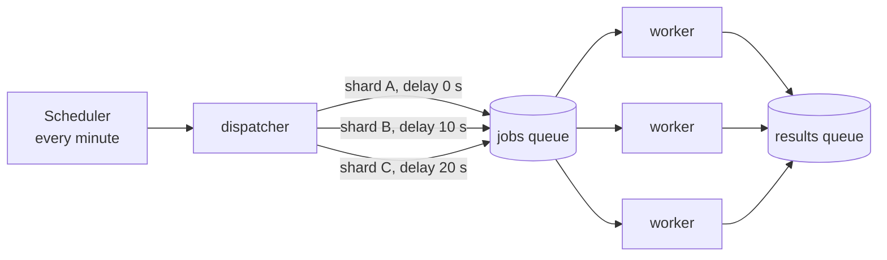

# Fan-out and load spreading

> **TL;DR**
>
> 1. **Load spreading:** never let a schedule synchronize a crowd. Give each item a stable offset,
>    `hash(id) % period`, so the load is flat instead of spiky.
> 2. **Fan-out:** split one big job into many small shards that run in parallel, each well inside
>    its limits (connections, memory, time).
> 3. Sentinel does both with a **dispatcher** that puts shards on a **delay queue** for parallel **workers**.

---

## What it is and why

**The thundering herd:** when many things happen at the same moment (every monitor checked at :00,
every cron job at midnight, every client retrying the instant a server comes back), the system needs
huge capacity for one second and sits idle the rest of the time. Systems fall over at peak, not on average.

**Load spreading** assigns each item a **stable offset** within the period:

```
offset_seconds = hash(monitor_id) % 60
```

The hash spreads ids roughly evenly across 0–59, and it's **stable**: the same monitor always gets
the same slot, so its checks stay exactly 60 s apart.

**Fan-out** splits one job too big for a single worker into **shards** processed in parallel. The
opposite step, collecting the results back together, is **fan-in**.



## How Sentinel uses it

Per probe region, every minute ([ADR-0003](../adr/0003-probe-fan-out-with-delay-queue.md)):

1. The dispatcher puts monitors into **6 buckets of 10 s** by `hash(monitor_id) % 60`.
2. Each bucket is split into **shards of ≤ 200 monitors**.
3. Each shard goes to the jobs queue with **`DelaySeconds` = bucket offset**. This is how we get
   sub-minute timing, even though the scheduler only fires once a minute.
4. Workers run shards in parallel, each with a **concurrency limit**, comfortably below Lambda's
   **1,024 open file descriptors** per run.

| Without spreading or fan-out | With them |
|---|---|
| 30,000 checks in 1 second | ~500 checks/s, steady |
| 1 run needing ~1,700 connections (over the limit) | Many runs of ≤ 200 monitors each |
| Billed for 60 s of sleeping per minute | Billed only for checking |

## Key terms

| Term | Meaning |
|---|---|
| **Thundering herd** | Many clients acting at the same instant and overwhelming a resource |
| **Jitter** | Random variation added to timing (e.g., retries) to avoid synchronized spikes |
| **Stable offset** | A deterministic per-item delay, so schedules stay regular *and* spread out |
| **Shard** | One slice of a larger workload |
| **Fan-out / fan-in** | Split work into parallel pieces / gather their results |
| **Concurrency limit (bulkhead)** | A cap on how many things run at once, so one job can't exhaust a resource |
| **Delay queue** | A queue whose messages become visible only after a set delay (SQS `DelaySeconds`, ≤ 15 min) |

## Common mistakes

- **Random offsets chosen fresh every run:** that spreads load, but the gap between a monitor's checks
  becomes irregular. Use a **stable** hash.
- **Unbounded concurrency:** firing all requests at once hits file-descriptor, memory or rate limits.
- **Fan-out without fan-in visibility:** if you can't tell when all shards finished (or which one
  failed), you can't trust the round. Workers emit metrics per shard.
- **Forgetting the target side:** spreading also protects the *customer's* site from bursts.

## Interview questions

1. **What is a thundering herd, and how do you prevent it?** Many clients acting simultaneously.
   Prevent it with spreading (stable offsets), jitter on retries, rate limiting, and caching (a CDN for status pages).
2. **How would you run 10,000 HTTP checks a minute on Lambda?** Fan out: a dispatcher shards the
   work, a queue with per-message delays spreads it across the minute, and many workers run shards in
   parallel with concurrency limits.
3. **Why a stable hash instead of random offsets?** A stable hash keeps each item's period exact
   (always 60 s apart) while still spreading items evenly.
4. **What limits a single Lambda run's concurrency?** File descriptors (1,024), memory, and the
   15-minute maximum run time. Shard so each run stays well inside them.
