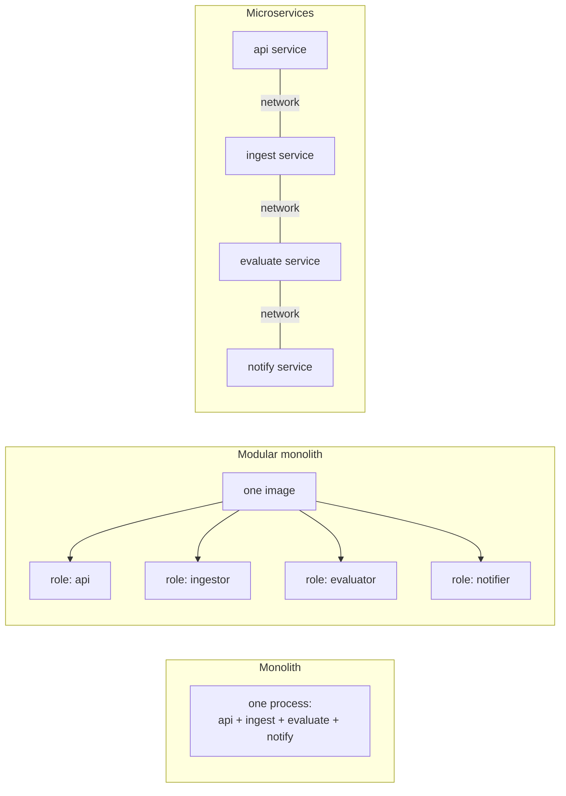

# Monolith vs modular monolith vs microservices

> **TL;DR**
>
> 1. A **modular monolith** is one codebase and one image with clean internal modules, run as
>    several **roles**. You get independent scaling without the overhead of many services.
> 2. **Microservices** mainly solve an *organizational* problem (many teams deploying independently),
>    not a technical one. They add network failures, distributed transactions and N× the pipelines.
> 3. Start with a modular monolith; split out a service only when a clear signal says so.

---

## What it is and why



| | Monolith | Modular monolith | Microservices |
|---|---|---|---|
| Deployable units | 1 | 1 image, N roles | N |
| Independent scaling | ❌ | ✅ (one Deployment per role) | ✅ |
| Fault isolation | ❌ | ✅ (separate processes) | ✅ |
| CI/CD pipelines | 1 | 1 | N |
| Calls between parts | In-process | In-process / shared DB | Network (latency, failures, retries) |
| Transactions across parts | Easy | Easy | Hard (sagas, outbox, eventual consistency) |
| Independent releases | ❌ | ❌ | ✅ |
| Best fit | Small apps | One team, varied load per part | Many teams, separate release rhythms |

## How Sentinel uses it

`sentinel-core` is one Python codebase and one Docker image. Kubernetes runs it as separate
Deployments by role:

```
sentinel-core api          → Deployment "api"        (scales on CPU)
sentinel-core ingestor     → Deployment "ingestor"   (scales on queue depth)
sentinel-core evaluator    → Deployment "evaluator"  (1–2 replicas)
sentinel-core notifier     → Deployment "notifier"
sentinel-core summarizer   → Deployment "summarizer"
sentinel-core publisher    → Deployment "publisher"
sentinel-core rollup       → CronJob (hourly)
```

The probe is separate because it runs somewhere else (Lambda in 3 regions), not because of a microservices ideology.
See [ADR-0001](../adr/0001-modular-monolith-core.md).

## Key terms

| Term | Meaning |
|---|---|
| **Role / entrypoint** | Which part of the codebase a process runs, chosen by a command argument |
| **Module boundary** | A rule that module A only calls module B through its public interface |
| **Distributed monolith** | The worst of both: many services that must still be deployed together because they're tightly coupled |
| **Saga** | A sequence of local transactions with compensating actions, used when one transaction can't span services |
| **Conway's law** | Systems tend to mirror the communication structure of the organization that builds them |

## Common mistakes

- **Choosing microservices because they're "modern".** Interviewers will ask why; "independent team
  deployments" is a real answer, "it's what Netflix does" isn't.
- **A distributed monolith:** services that share a database and must release together. All the
  costs, none of the benefits.
- **A big ball of mud:** a modular monolith whose modules reach into each other's internals.
  Boundaries need discipline and review.
- **Splitting too early,** before the domain boundaries are understood. Wrong boundaries in
  microservices are very expensive to move.

## Interview questions

1. **Monolith or microservices for a new product?** Usually start with a (modular) monolith: faster to
   build and change while the domain is still being learned. Split when team size, scaling needs or
   release independence demand it.
2. **What are the hidden costs of microservices?** Network latency and failures, distributed
   transactions, N pipelines and charts, harder debugging (needs distributed tracing), versioned APIs
   between services.
3. **How can a monolith scale parts independently?** Run the same image as different roles, each its
   own Deployment with its own replicas and autoscaling.
4. **What's a real-world example of moving back to a monolith?** Amazon Prime Video (2023) moved a
   video-quality monitoring service from distributed components to a monolith and cut
   infrastructure costs by about 90%.
