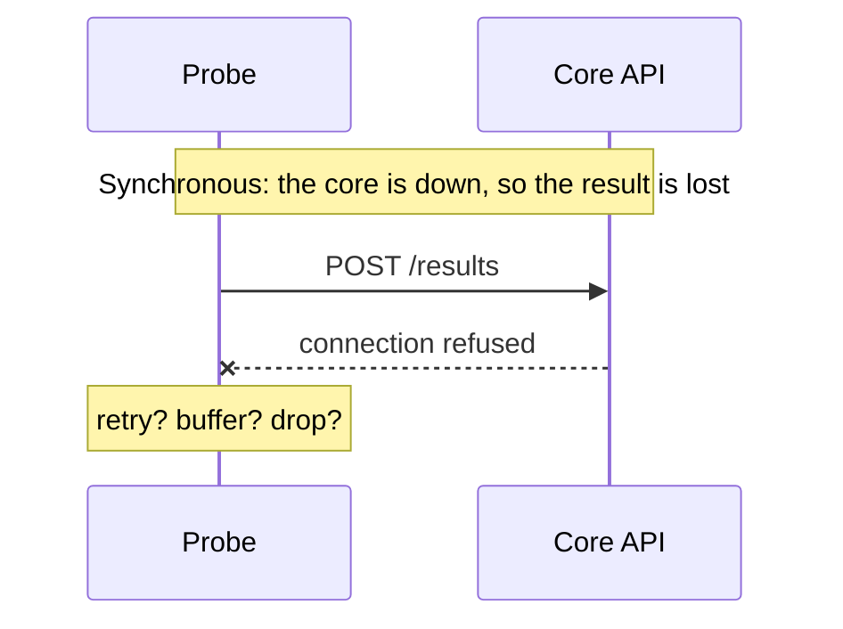
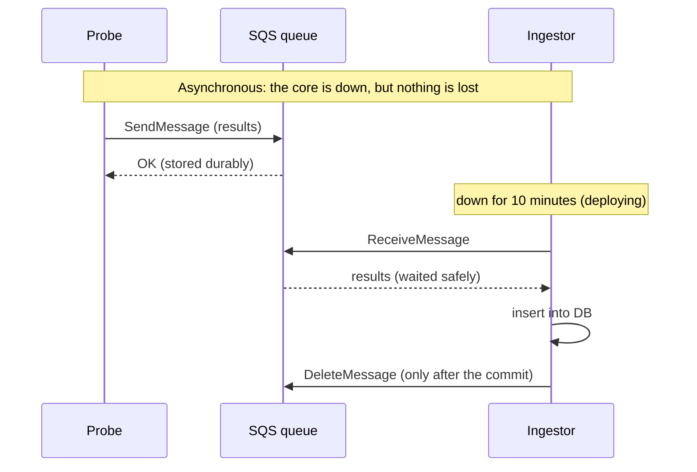

# Sync vs async communication, and queues

> **TL;DR**
>
> 1. **Sync** = the caller waits for an answer (a phone call). **Async** = the sender leaves a message
>    and moves on (voicemail). Use sync when you need the answer now, async when the work can happen later.
> 2. A **queue** decouples sender and receiver in time: the receiver can be down, slow or scaling,
>    and nothing is lost. It also absorbs spikes.
> 3. The price is **at-least-once delivery**: duplicates happen, so consumers must be **idempotent**.

---

## What it is and why

**Synchronous:** the caller sends a request and **blocks** until it gets a response. Simple to
reason about, but both sides must be up *at the same time* (**temporal coupling**), and a slow
receiver makes the caller slow too.

**Asynchronous:** the sender puts a message in a **queue** and continues. A consumer takes messages
when it's ready. Sender and receiver no longer need to be up at the same moment.

## Benefits of async (with a queue)

| Benefit | Meaning |
|---|---|
| **Temporal decoupling** | The consumer can be down, redeploying or slow; messages wait (SQS: up to 14 days) |
| **Load levelling** | Spikes pile up in the queue; consumers drain it at a steady pace |
| **Independent scaling** | Add consumers when the backlog grows (KEDA scales on queue depth) |
| **Failure isolation** | Messages that keep failing go to a **dead-letter queue** instead of blocking everything |

## Delivery guarantees

| Guarantee | Meaning | Risk |
|---|---|---|
| **At-most-once** | Send once, never retry | Messages can be **lost** |
| **At-least-once** | Retry until acknowledged | Messages can be **duplicated** |
| **Exactly-once** | Each message processed exactly once | Impossible to guarantee end-to-end over a network in general |

In practice we get **"effectively once" = at-least-once delivery + an idempotent consumer.**
Sentinel's ingestor inserts with `ON CONFLICT (check_id) DO NOTHING`, so a duplicate does nothing.

**Where SQS duplicates come from:** when a consumer receives a message, SQS hides it for the
**visibility timeout** (e.g., 30 s). If the consumer doesn't delete it in time (it crashed, or was
too slow), the message **reappears** and gets processed again. That's why we delete only *after*
the database commit: crash before the commit → the message comes back (good); crash after the
commit but before the delete → a duplicate arrives, and idempotency absorbs it.

## How Sentinel uses it

| Interaction | Style |
|---|---|
| Dashboard → api | Sync: the user needs "saved ✓" now |
| Dispatcher → jobs queue → workers | Async: delays spread load; workers run in parallel |
| Workers → results queue → ingestor | Async: never lose results when the core is down |
| Evaluator → outbox → notifier / summarizer | Async: slow Slack or LLM calls never delay detection |
| Publisher → S3 → CDN | Async snapshot: the status page survives a core outage |

## Key terms

| Term | Meaning |
|---|---|
| **Producer / consumer** | The sender / receiver of messages |
| **Visibility timeout** | How long a received message stays hidden before it reappears if not deleted |
| **Long polling** | `ReceiveMessage` waits up to 20 s for messages instead of returning empty right away; fewer requests, lower cost |
| **Dead-letter queue (DLQ)** | Where messages go after N failed attempts (`maxReceiveCount`), for inspection |
| **Idempotent** | Doing it twice has the same effect as doing it once |
| **Backlog / queue depth** | Messages waiting; a key scaling and alerting signal |
| **Age of oldest message** | How far behind consumers are; often a better alert than depth |

## Common mistakes

- **Deleting the message before the work is committed.** A crash in between loses data.
- **Assuming exactly-once.** Without idempotency, duplicates create double rows or double alerts.
- **No DLQ.** One poison message (one that always fails) gets retried forever and hides real problems.
- **Alerting only on queue depth.** A small queue that isn't moving is worse than a big one that is;
  alert on the age of the oldest message too.
- **Using async for everything.** If the user is waiting for an answer, a queue just makes the experience worse.

## Interview questions

1. **When would you choose async over sync?** When the caller doesn't need an immediate answer, and
   you want decoupling, spike absorption or independent scaling. For example: background jobs,
   events, ingestion pipelines.
2. **What does at-least-once delivery mean for your code?** Duplicates will happen, so consumers must
   be idempotent: a unique key with "insert if not exists", or checking whether the work was already done.
3. **Why does SQS deliver duplicates?** The visibility timeout: if a message isn't deleted before it
   expires (crash or slowness), it becomes visible again and is redelivered.
4. **What's a dead-letter queue for?** Isolating messages that fail repeatedly, so they don't block
   or loop forever, and so you can inspect them and alert on them.
5. **SQS vs Kafka?** SQS is a managed work queue: each message is processed by one consumer and then
   deleted, with no servers. Kafka is a distributed log: ordered within a partition, replayable, read
   by many consumer groups, higher throughput, more to operate.
